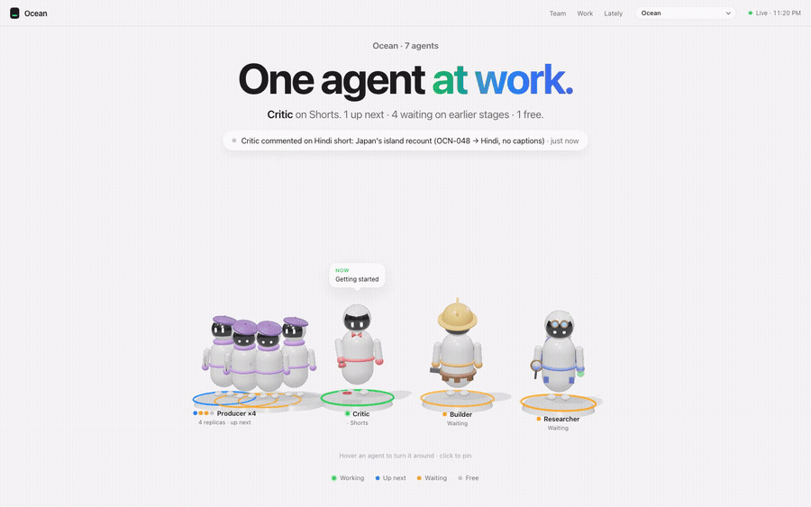
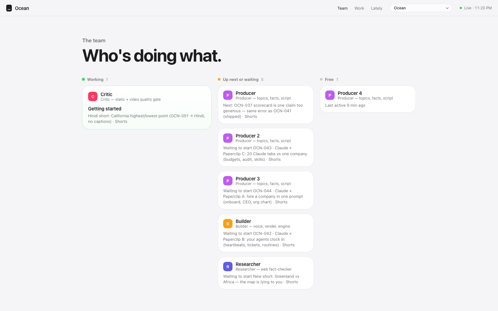
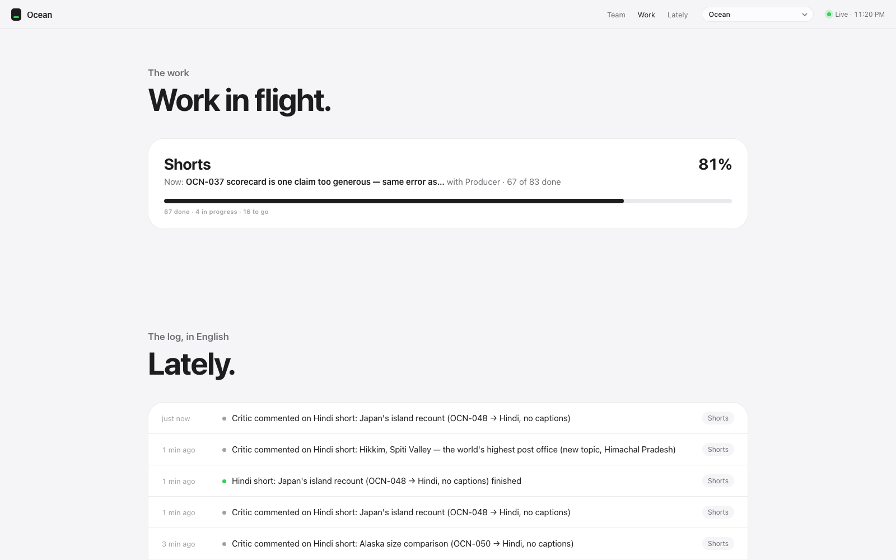

# Paperclip Studio

**Your AI agents are working. Who is doing what, who is stuck, and what ships next, without reading logs?**

Paperclip Studio turns any [Paperclip](https://paperclip.ing) company into a calm 3D studio: one character per agent, plain-English status, workstream progress, and a live activity feed. Read-only, zero dependencies, works on your phone.

## [Try the live demo](https://paperclip-studio-drab.vercel.app)

No install, no Paperclip instance needed. It runs on sample data.



## Quickstart

```bash
git clone https://github.com/soniAnkur/paperclip-studio.git
cd paperclip-studio && npm start
# open http://127.0.0.1:4300
```

No Paperclip instance? It ships with sample data. To see your own company: `PAPERCLIP_API=http://127.0.0.1:3100/api npm start`

**Star the repo to follow along. New feature every few days.**

[1-minute walkthrough](docs/media/promo.mp4)

| Team | Work |
|---|---|
|  |  |

## Run it locally

Open http://127.0.0.1:4300 after `npm start`. If no Paperclip API is reachable, you'll see a "Demo data" banner and a fictional sample company instead of an error.

## Pointing it at your own Paperclip

```bash
PAPERCLIP_API=http://127.0.0.1:3100/api npm start
```

| Env var | Default | What it does |
|---|---|---|
| `PAPERCLIP_API` | `http://127.0.0.1:3100/api` | Your Paperclip instance's API base URL |
| `STUDIO_PORT` | `4300` | Port Studio listens on |
| `STUDIO_HOST` | `127.0.0.1` | Host Studio binds to |
| `STUDIO_DEMO` | unset | Set to `1` to force sample data, even if a real Paperclip is reachable |

Visit a specific company at `/c/<issue-prefix-or-id>`, e.g. `/c/PAP`.

## What it does (and doesn't do)

Studio polls your Paperclip API's `/companies`, `/agents`, `/issues`, `/activity`, and `/heartbeat-runs` endpoints and renders the result. It never writes anything back — there is no create, update, or delete path anywhere in the client or server. If you can see it in Studio, it already happened in Paperclip.

## Status

Not affiliated with or endorsed by paperclip.ing — an independent, community project for a tool I use daily.

## Credits

Built on [three.js](https://threejs.org) (MIT).

## License

MIT — see [LICENSE](LICENSE).
